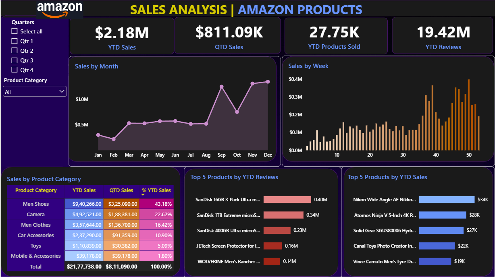

# Amazon Products Analysis Dashboard

## Project Overview

An interactive Power BI dashboard exploring product-category values,
monthly and weekly patterns, and product rankings by price-sum and
review-count measures. The project demonstrates Power BI reporting, DAX
time-intelligence calculations, date-table creation, and interactive
filtering.

> **Metric note:** The supplied DAX formulas sum `Price(Dollar)` for
> YTD/QTD "Sales," count nonblank `Product Category` values for "YTD
> Products Sold," and sum `Number of reviews` for "YTD Reviews." The
> source fields do not establish that these are transaction revenue,
> units sold, or reviews newly received. Interpret the metrics
> accordingly.

## Dashboard Preview



Open `dashboard/amazon_sales_analysis_dashboard.pbix` in Power BI
Desktop to explore the report.

## Key Findings

-   **Category concentration:** Men Shoes contributes **43.18%** and
    Camera **22.62%** of the displayed YTD sum-of-price measure.
    Together, they account for approximately **65.8%**.
-   **Uneven monthly pattern:** The all-category chart shows a marked
    rise in September, a drop in October, and high values again in
    November and December.
-   **Weekly variation:** The weekly chart shows noticeable differences
    between weeks; week-number logic should be validated across years.
-   **Filterable analysis:** Quarter and product-category slicers let
    users explore KPI cards, trends, and top-product rankings by
    selected context.

See [`docs/business_insights.md`](docs/business_insights.md) for
interpretation, recommendations, and limitations.

## Dashboard Components

### KPI cards

-   YTD Sales
-   QTD Sales
-   YTD Products Sold
-   YTD Reviews

### Visualizations

-   Sales by Month --- line chart
-   Sales by Week --- column chart
-   Sales by Product Category --- table with YTD, QTD, and share columns
-   Top 5 Products by YTD Reviews --- bar chart
-   Top 5 Products by YTD Sales --- bar chart

### Filters

-   Quarter slicer
-   Product Category slicer

## Dataset

File: `data/amazon_products_raw_data.xlsx`\
Worksheet: `Amazon_Data`

  -----------------------------------------------------------------------
  Column                              Description
  ----------------------------------- -----------------------------------
  `Product Category`                  Product category label

  `Product Description`               Product description/name

  `Price(Dollar)`                     Price-like numeric value; not
                                      confirmed transaction revenue

  `Number of reviews`                 Review-count field; confirm whether
                                      cumulative or period-specific

  `Shipment`                          Shipment-related field; meaning
                                      should be confirmed from the source

  `Order Date`                        Date field used for time-based
                                      calculations
  -----------------------------------------------------------------------

The workbook was observed to contain 89,082 rows. The date range and row
count should be reconfirmed if the source workbook changes.

**Dataset source and license:** Add the verified original dataset URL
and check redistribution permission before uploading the workbook
publicly. Do not imply the dataset is official Amazon transaction data
unless the source confirms this.

## Power BI Model and DAX

A date table is created from the minimum and maximum `Order Date`:

``` dax
Date Table =
CALENDAR (
    MIN ( Amazon_Data[Order Date] ),
    MAX ( Amazon_Data[Order Date] )
)
```

The report includes month, quarter, and week fields derived from the
date. The date table is related to `Amazon_Data`.

Current measure definitions:

``` dax
QTD Sales =
TOTALQTD (
    SUM ( Amazon_Data[Price(Dollar)] ),
    'Date Table'[Date]
)
```

``` dax
YTD Products Sold =
TOTALYTD (
    COUNT ( Amazon_Data[Product Category] ),
    'Date Table'[Date]
)
```

``` dax
YTD Reviews =
TOTALYTD (
    SUM ( Amazon_Data[Number of  reviews] ),
    'Date Table'[Date]
)
```

``` dax
YTD Sales =
TOTALYTD (
    SUM ( Amazon_Data[Price(Dollar)] ),
    'Date Table'[Date]
)
```

These are the formulas supplied for this project. The sales measures sum
the price field, and the products-sold measure counts nonblank category
values. Confirm the source data's grain before describing them as actual
revenue or units sold. If review counts are cumulative product-level
values, the YTD review calculation may not represent new reviews
received during the year.

## Tools

-   Microsoft Power BI Desktop
-   DAX
-   Microsoft Excel

List Power Query as a project technique only if you used it for the
actual data preparation.

## Repository Structure

``` text
amazon-sales-analysis-powerbi/
├── .gitignore
├── README.md
├── data/
│   ├── amazon_products_raw_data.xlsx
│   └── data_dictionary.md
├── dashboard/
│   └── amazon_sales_analysis_dashboard.pbix
├── docs/
│   ├── problem_statement.md
│   ├── kpi_definitions.md
│   ├── data_cleaning_notes.md
│   └── business_insights.md
└── images/
    └── amazon_sales_dashboard.png
```

## How to Open

1.  Clone or download this repository.
2.  Open `dashboard/amazon_sales_analysis_dashboard.pbix` in Power BI
    Desktop.
3.  If prompted, reconnect the source to
    `data/amazon_products_raw_data.xlsx`.
4.  Refresh the report and test the quarter/category slicers.

## Limitations

-   The sales measure is a sum of prices, not verified transaction
    revenue.
-   The current products-sold measure counts nonblank category entries.
-   Review-count semantics require source verification.
-   Findings are descriptive and do not establish why monthly or weekly
    values change.
-   Confirm the dataset source and license before public redistribution.
